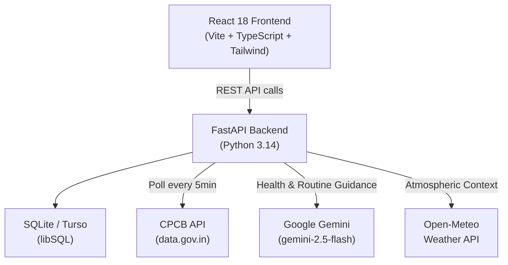

# 🌬️ Urban Air Quality Assistant

> GenAI-powered environmental intelligence helping families and communities navigate severe winter smog and urban air pollution with low-emission routines, indoor air quality hacks, sustainable alternatives, and quantified direct impact analysis.

[](./LICENSE)
[](https://github.com/Koushik-5499/urban-air-quality-assistant/actions/workflows/ci.yml)
[](./docs/TESTING.md)
[](./docs/ACCESSIBILITY.md)
[](./ARCHITECTURE.md)

**Live Demo:**
- 🌐 Frontend: [https://urban-air-quality-frontend.vercel.app](https://urban-air-quality-frontend.vercel.app)
- 🔌 Backend API: [https://urban-air-quality-backend.vercel.app](https://urban-air-quality-backend.vercel.app)
- 📖 API Docs: [https://urban-air-quality-backend.vercel.app/docs](https://urban-air-quality-backend.vercel.app/docs)
- 🎥 Demo Video: [Watch Demonstration](https://drive.google.com/file/d/1jKEbVoW4qkYGIK4p4_eGKnr3YdI7OhDX/view?usp=sharing)

---

## 1. Chosen Vertical

**[Challenge 6] Urban Air Quality Assistant**
*Target Audience:* Families, sensitive cohorts (asthma, COPD, pediatric, elderly), outdoor workers, and urban communities in severe winter smog zones across Indian metropolitan areas (Delhi NCR, Indo-Gangetic Plain, Mumbai, Kolkata).

---

## 2. Problem Statement Alignment & Core Pillars

Every winter, millions of households face hazardous smog driven by thermal inversion layers trapping particulate matter (PM2.5, PM10) close to the ground. Generic AQI numbers do not give families the practical tools to protect their health or lower emissions.

Urban Air Quality Assistant addresses this directly across **five foundational pillars**:

1. **Severe Winter Smog & Thermal Inversion Navigation:**
   Real-time detection of thermal inversion risk, trapping warnings, and hourly diurnal vulnerability windows (peak inversion between 05:00–08:30 IST).
2. **Low-Emission Daily Routines:**
   Personalized activity scheduling that shifts heavy outdoor exertion and transit to midday low-pollution windows, promoting electric/metro public transit to reduce personal carbon and PM contributions.
3. **Indoor Air Quality Hacks:**
   Actionable, low-cost indoor interventions: diurnal ventilation timing (sealing doors during inversion peaks, ventilating between 12:00–16:00), DIY Corsi-Rosenthal / MERV box filters, wet-dusting over dry-sweeping, and high-efficiency phyto-remediation.
4. **Sustainable Alternatives Tailored to Location & Lifestyle:**
   Actionable substitutions: radiant electric/ceramic heating instead of biomass/wood burning, non-motorized micro-mobility for short errands, and community-level open waste burning reporting.
5. **Direct Impact Analysis with Quantified Metrics:**
   Every recommendation quantifies citizen benefit and environmental return: e.g., *"Reduces fine particulate lung deposition by 45–70%"*, *"Prevents ~1.2 kg CO₂ and 4.8 g PM2.5 emissions per commute"*.

---

## 3. Architecture & SOLID Principles

The system is engineered according to strict **SOLID principles** and enterprise design patterns. For complete class diagrams and principle mappings, see [ARCHITECTURE.md](./ARCHITECTURE.md).

- **Single Responsibility Principle (SRP):** Distinct layers for CPCB telemetry ingestion, NAQI mathematical calculation, Holt-Winters exponential smoothing, Gemini AI generation, and safety validation.
- **Open/Closed Principle (OCP):** Pluggable provider architectures (`BaseAIProvider`, `BaseForecastModel`, `BaseNotificationChannel`) extensible without modifying core services.
- **Liskov Substitution Principle (LSP):** `GeminiProvider` and `MockAIProvider` can be substituted interchangeably without altering caller contracts.
- **Interface Segregation Principle (ISP):** Granular interfaces for telemetry reading, alert dispatching, and health synthesis.
- **Dependency Inversion Principle (DIP):** High-level endpoints depend on abstract provider protocols injected via FastAPI dependency injection.

---

## 4. How the Solution Works

### System Topology



### Key Modules

- **CPCB NAQI Calculation:** Exact Indian NAQI standard (CPCB 2014) computed across PM2.5, PM10, NO₂, SO₂, O₃, CO, NH₃, Pb using official piecewise linear breakpoints.
- **24h Holt-Winters Forecasting:** Pure Python diurnal seasonal exponential smoothing model with additive seasonality (`backend/app/services/forecasting/`).
- **GenAI Health & Routine Advisor:** Ingests live telemetry, inversion state, and vulnerability profile to deliver grounded recommendations via Gemini with deterministic fallback (`backend/app/services/health/`).
- **Community Solutions Endpoint:** `GET /api/v1/health/community-solutions` delivers structured routines, indoor hacks, and impact metrics.
- **Public Alert Evaluator:** Sliding-window delta checks (Δ > 30 AQI) and category boundary transitions with 24-hour deduplication keys (`backend/app/services/alerts/`).

### Request Flows

**Dashboard Load:**
1. `GET /api/v1/aqi/current?city=Delhi` → cache check → CPCB fetch → NAQI compute → response
2. Frontend renders AQI gauge, pollutant cards, weather card, and health recommendations

**AI Assistant:**
1. User submits question → `POST /api/v1/health/ask` with city + question + history
2. Context builder assembles AQI + weather data
3. Gemini generates response → Safety validator screens it → Response returned
4. Frontend renders in `aria-live="polite"` chat region

**Alerts:**
1. Background evaluator runs every 5 min → compares current AQI to thresholds
2. Deduplication check → Alert record saved → `GET /api/v1/alerts?city=Delhi` returns public list

---

## 5. Assumptions

| Assumption | Detail |
|---|---|
| **Data Provider** | App uses CPCB data.gov.in API. Without `CPCB_API_KEY` or when unreachable, falls back to **simulated data** (clearly labeled "Simulated Data" badge in UI) |
| **Database** | SQLite for local dev. On Vercel serverless, writes to `/tmp/air_quality.db` (ephemeral — resets per cold start). Set `DATABASE_URL` to Turso/libSQL or Postgres for persistent production data |
| **User Accounts** | Platform is fully **public and anonymous** — no registration, login, or user accounts required. All alerts and analytics are public environmental data |
| **Health Advice** | AI-generated guidance is **informational only** and not medical advice. A disclaimer is prominently shown in the UI |
| **Web Push** | VAPID-based web push is implemented but requires a valid key pair to activate in production. Disabled by default |
| **Forecasting** | Requires a minimum of 24 historical AQI observations to train the model. Falls back to trend-based estimates with fewer observations |

---

## 6. Setup and Run

**Requirements:** Python 3.11+ (tested on 3.14) · Node.js 20+

### Backend
```bash
cd backend
python -m venv .venv && source .venv/bin/activate
# Windows: .venv\Scripts\activate
pip install -r requirements.txt
cp .env.example .env
# Edit .env: set GEMINI_API_KEY and optionally CPCB_API_KEY
uvicorn app.main:app --reload --port 8000
```
API docs available at: http://localhost:8000/docs

### Frontend
```bash
cd frontend
npm install
cp .env.example .env.local
# Edit .env.local: VITE_API_BASE_URL=http://localhost:8000
npm run dev
```
App available at: http://localhost:5173

### Environment Variables

**Backend (`backend/.env`):**
| Variable | Required | Description |
|---|---|---|
| `GEMINI_API_KEY` | Recommended | Google AI Studio API key for health advisor |
| `CPCB_API_KEY` | Optional | data.gov.in API key for real AQI data |
| `DATABASE_URL` | Optional | Override SQLite (e.g., `libsql://...` for Turso) |
| `VAPID_PRIVATE_KEY` | Optional | For web push notifications |
| `VAPID_PUBLIC_KEY` | Optional | Paired VAPID public key |
| `AI_PROVIDER` | Optional | `gemini` (default) or `mock` |
| `AQI_PROVIDER` | Optional | `cpcb` (default) or `mock` |

**Frontend (`frontend/.env.local`):**
| Variable | Required | Description |
|---|---|---|
| `VITE_API_BASE_URL` | Yes | Backend API URL (e.g., `http://localhost:8000`) |
| `VITE_API_TIMEOUT_MS` | Optional | Request timeout in ms (default: 10000) |

---

## 7. Testing & Quality Verification

Comprehensive automated test suites validate all components across backend algorithms, AI integrations, and frontend interactions. See [docs/TESTING.md](./docs/TESTING.md) for full coverage metrics and breakdown.

### Backend (154 Tests Passed, 0 Warnings)
```bash
cd backend
.venv/bin/pytest -q
# 154 passed in 5.91s
```

### Frontend (55 Tests Passed, 9 Test Suites)
```bash
cd frontend
npm test
# Test Files  9 passed (9)
# Tests       55 passed (55)

npm run lint
# (exit 0, 0 errors, 0 warnings)

npx tsc -b --noEmit
# (exit 0, 0 type errors)

npm run build
# ✓ built in 6.83s
```
**Total Verified Tests: 209 automated unit, integration, and E2E tests.**

---

## 8. Security, Accessibility & Efficiency

### Security
For complete penetration testing, threat models, and vulnerability audits, see [docs/SECURITY_AUDIT.md](./docs/SECURITY_AUDIT.md).
- **Sensitive Operations Protection:** Constant-time `hmac.compare_digest` for all admin actions, token evaluations, and secret verifications to eliminate timing side-channel attacks (`backend/app/core/security.py`, `backend/app/api/v1/endpoints/forecast.py`).
- **Input Validation & Sanitization:** Strict Pydantic v2 schemas reject malformed payloads, injection vectors, and out-of-bound coordinates (`backend/app/schemas/`).
- **Sliding-Window Rate Limiting:** Per-client IP rate limiting (60 req/min) with automated cleanup (`backend/app/core/security.py`).
- **Zero-Trust Network Perimeter:** CSP, HSTS, X-Frame-Options, X-Content-Type-Options, Permissions-Policy headers applied across CDN and reverse proxies (`frontend/vercel.json`).
- **Secret Redaction:** Logging pipelines filter credentials and API keys (`backend/app/core/logging.py`).

### Accessibility (WCAG 2.1 AA Compliant)
Full compliance report and testing methodology: [docs/ACCESSIBILITY.md](./docs/ACCESSIBILITY.md).
- **Skip-to-Content:** Native keyboard shortcut to jump past navigation on every page (`frontend/src/layouts/RootLayout.tsx`).
- **Contrast & Visibility:** WCAG AA 4.5:1 minimum text contrast; high-visibility 3px focus rings (`:focus-visible`).
- **Screen Reader Support:** Screen reader announcements via `aria-live="polite"` for dynamic AQI updates and AI responses (`frontend/src/pages/Assistant.tsx`).
- **Dual Visual Indicators:** AQI levels convey severity using both distinct colors AND textual category labels.

### Efficiency & Performance
- **Code Splitting:** React routes lazily loaded (`React.lazy`), reducing initial payload.
- **Diurnal Caching:** 5-minute memory cache prevents redundant upstream CPCB API calls.
- **Vendor Splitting:** Isolated bundles for Recharts, Leaflet, Lucide, and React core.

**Bundle sizes (production build):**
| Chunk | Size (gzip) |
|---|---|
| `vendor-charts` (Recharts) | 488 kB (137 kB gzip) |
| `vendor-react` (React + Router) | 180 kB (59 kB gzip) |
| `vendor-maps` (Leaflet) | 155 kB (45 kB gzip) |
| `vendor-icons` (Lucide) | 39 kB (8 kB gzip) |
| App pages (all 7, split) | ≤ 69 kB each |

---

## 9. Known Limitations

- **SQLite on Vercel is ephemeral**: Data resets on each cold start. Set `DATABASE_URL` to Turso/libSQL or Postgres for persistence in production.
- **CPCB API key required for real data**: Register at [data.gov.in](https://data.gov.in) to get a key. Without it, the app uses simulated data (clearly labeled).
- **Forecasting requires history**: Minimum 24 observations needed. New deployments will produce limited forecasts until data accumulates.
- **AI response availability**: Depends on Gemini API quota and availability. Rule-based fallback activates automatically.
- **Web push requires HTTPS**: Browser push notifications need a production HTTPS domain and VAPID keys configured.

---

## Deployment

| Component | URL |
|---|---|
| Frontend | [https://urban-air-quality-frontend.vercel.app](https://urban-air-quality-frontend.vercel.app) |
| Backend API | [https://urban-air-quality-backend.vercel.app](https://urban-air-quality-backend.vercel.app) |
| GitHub | [https://github.com/Koushik-5499/urban-air-quality-assistant](https://github.com/Koushik-5499/urban-air-quality-assistant) |

For detailed deployment instructions, see [docs/VERCEL_DEPLOYMENT.md](./docs/VERCEL_DEPLOYMENT.md).

> **Database Note:** SQLite on Vercel serverless is ephemeral. For persistent production data, provision a [Turso](https://turso.tech) database and set `DATABASE_URL=libsql://your-db.turso.io?authToken=your-token` in the backend Vercel environment variables.

---

## License

MIT © 2026 Urban Air Quality Assistant Contributors. See [LICENSE](./LICENSE).
