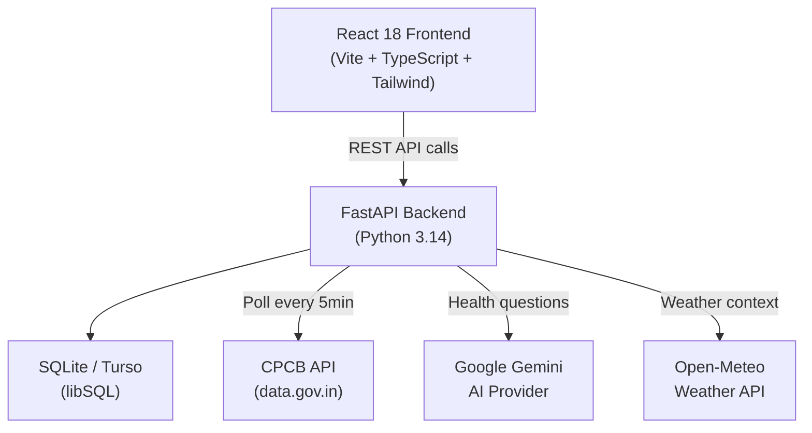

# 🌬️ Urban Air Quality Assistant

> Real-time ambient air quality monitoring and AI-powered health advisory for Indian cities.

[](./LICENSE)
[](https://github.com/Koushik-5499/urban-air-quality-assistant/actions/workflows/ci.yml)

**Live Demo:**
- 🌐 Frontend: [https://urban-air-quality-frontend.vercel.app](https://urban-air-quality-frontend.vercel.app)
- 🔌 Backend API: [https://urban-air-quality-backend.vercel.app](https://urban-air-quality-backend.vercel.app)
- 📖 API Docs: [https://urban-air-quality-backend.vercel.app/docs](https://urban-air-quality-backend.vercel.app/docs)

---

## 1. Chosen Vertical

**Urban Air Quality Monitoring & Health Advisory** — serving citizens, outdoor workers, parents, elderly residents, and health-conscious individuals in Indian metropolitan areas.

---

## 2. Problem Statement and Why It Matters

India hosts 14 of the world's 20 most polluted cities. The Central Pollution Control Board (CPCB) publishes real-time AQI data, but this raw telemetry is inaccessible to everyday citizens without technical knowledge. There is no unified, accessible platform that:

- Translates CPCB data into understandable health guidance
- Delivers personalized advice based on user vulnerability (asthma, elderly, children, outdoor workers)
- Forecasts tomorrow's air quality to help people plan activities in advance
- Alerts communities when local AQI crosses dangerous thresholds

The Urban Air Quality Assistant bridges this gap: it ingests CPCB telemetry, computes NAQI indices using official breakpoints, generates AI-powered health recommendations via Google Gemini, and presents everything in an accessible, responsive dashboard.

---

## 3. Approach and Logic

### CPCB NAQI Calculation
The app uses the **Indian National Air Quality Index (NAQI)** standard (CPCB 2014):

- Sub-indices are computed for each pollutant (PM2.5, PM10, NO₂, SO₂, O₃, CO, NH₃, Pb) using official concentration breakpoints
- The overall AQI is the **maximum sub-index** (worst-pollutant rule)
- The dominant pollutant is the one driving the maximum sub-index
- Six categories: Good (0–50), Satisfactory (51–100), Moderate (101–200), Poor (201–300), Very Poor (301–400), Severe (401–500+)

**Code:** `backend/app/services/aqi/`

### Forecasting (Exponential Smoothing)
24-hour AQI forecasts use **Holt-Winters Exponential Smoothing** because:
- AQI data exhibits diurnal seasonality (morning rush hour, evening traffic)
- Exponential smoothing handles missing observations gracefully (serverless SQLite is ephemeral)
- No external ML dependencies — pure Python numerics, deployable to Vercel serverless

**Code:** `backend/app/services/forecasting/`

### AI Health Advisor (Gemini + Safety Validator)
1. **Context builder** assembles current AQI, pollutant breakdown, weather, and historical trend
2. **Gemini** (`gemini-3.5-flash-lite`) generates personalized health guidance based on query and context
3. **Safety validator** blocks responses containing medical diagnoses, drug prescriptions, or unqualified certainty claims
4. **Rule-based fallback** provides deterministic CPCB-category recommendations when Gemini is unavailable

**Code:** `backend/app/services/health/`

### Alert Threshold & Deduplication
- Alerts trigger when AQI crosses CPCB category boundaries (e.g., Moderate → Poor)
- **Deduplication key** = `{city_id}:{severity}:{date}` — prevents duplicate alerts within 24 hours
- Sudden deterioration (Δ > 30 AQI) or significant improvement (Δ > 40 AQI) also triggers alerts

**Code:** `backend/app/services/alerts/`

---

## 4. How the Solution Works

### Architecture



### Request Flows

**Dashboard Load:**
1. `GET /api/v1/aqi/current?city=Delhi` → cache check → CPCB fetch → NAQI compute → response
2. Frontend renders AQI gauge, pollutant cards, weather card, and health recommendations

**AI Assistant:**
1. User submits question → `POST /api/v1/health/ask` with city + question + history
2. Context builder assembles AQI + weather data
3. Gemini generates response → Safety validator screens it → Response returned
4. Frontend renders in `aria-live="polite"` chat region

**Alerts:**
1. Background evaluator runs every 5 min → compares current AQI to thresholds
2. Deduplication check → Alert record saved → `GET /api/v1/alerts?city=Delhi` returns public list

---

## 5. Assumptions

| Assumption | Detail |
|---|---|
| **Data Provider** | App uses CPCB data.gov.in API. Without `CPCB_API_KEY` or when unreachable, falls back to **simulated data** (clearly labeled "Simulated Data" badge in UI) |
| **Database** | SQLite for local dev. On Vercel serverless, writes to `/tmp/air_quality.db` (ephemeral — resets per cold start). Set `DATABASE_URL` to Turso/libSQL or Postgres for persistent production data |
| **User Accounts** | Platform is fully **public and anonymous** — no registration, login, or user accounts required. All alerts and analytics are public environmental data |
| **Health Advice** | AI-generated guidance is **informational only** and not medical advice. A disclaimer is prominently shown in the UI |
| **Web Push** | VAPID-based web push is implemented but requires a valid key pair to activate in production. Disabled by default |
| **Forecasting** | Requires a minimum of 24 historical AQI observations to train the model. Falls back to trend-based estimates with fewer observations |

---

## 6. Setup and Run

**Requirements:** Python 3.11+ (tested on 3.14) · Node.js 20+

### Backend
```bash
cd backend
python -m venv .venv && source .venv/bin/activate
# Windows: .venv\Scripts\activate
pip install -r requirements.txt
cp .env.example .env
# Edit .env: set GEMINI_API_KEY and optionally CPCB_API_KEY
uvicorn app.main:app --reload --port 8000
```
API docs available at: http://localhost:8000/docs

### Frontend
```bash
cd frontend
npm install
cp .env.example .env.local
# Edit .env.local: VITE_API_BASE_URL=http://localhost:8000
npm run dev
```
App available at: http://localhost:5173

### Environment Variables

**Backend (`backend/.env`):**
| Variable | Required | Description |
|---|---|---|
| `GEMINI_API_KEY` | Recommended | Google AI Studio API key for health advisor |
| `CPCB_API_KEY` | Optional | data.gov.in API key for real AQI data |
| `DATABASE_URL` | Optional | Override SQLite (e.g., `libsql://...` for Turso) |
| `VAPID_PRIVATE_KEY` | Optional | For web push notifications |
| `VAPID_PUBLIC_KEY` | Optional | Paired VAPID public key |
| `AI_PROVIDER` | Optional | `gemini` (default) or `mock` |
| `AQI_PROVIDER` | Optional | `cpcb` (default) or `mock` |

**Frontend (`frontend/.env.local`):**
| Variable | Required | Description |
|---|---|---|
| `VITE_API_BASE_URL` | Yes | Backend API URL (e.g., `http://localhost:8000`) |
| `VITE_API_TIMEOUT_MS` | Optional | Request timeout in ms (default: 10000) |

---

## 7. Testing

### Backend
```bash
cd backend
.venv/bin/pytest -q
# 151 passed, 2 warnings in 5.85s
```

### Frontend
```bash
cd frontend
npm test
# Test Files  9 passed (9)
# Tests  54 passed (54)

npm run lint
# (exit 0, 0 errors, 0 warnings)

npx tsc -b --noEmit
# (exit 0, 0 type errors)

npm run build
# ✓ built in 5.29s
```

---

## 8. Security, Accessibility & Efficiency

### Security
- **Input validation**: All API inputs validated via Pydantic v2 schemas with strict type constraints (`backend/app/schemas/`)
- **Rate limiting**: Per-IP sliding window (60 req/min) with automatic pruning of expired entries (`backend/app/core/security.py`)
- **Secret comparison**: `hmac.compare_digest` for all admin key checks — prevents timing attacks (`backend/app/core/security.py`)
- **Request size limit**: 1 MB body size limit middleware (`backend/app/main.py`)
- **CORS**: Allowlist-based with configurable origins per environment (`backend/app/core/config.py`)
- **Security headers**: CSP, X-Frame-Options, X-Content-Type-Options, Referrer-Policy, Permissions-Policy (`frontend/vercel.json`)
- **X-Forwarded-For**: Only trusted when `TRUSTED_PROXY=true` to prevent IP spoofing
- **Secret redaction**: Logging filter strips API keys and credentials from all log output (`backend/app/core/logging.py`)
- **No secrets tracked**: `.env`, `dist/`, `__pycache__`, and `*.db` are gitignored

### Accessibility (WCAG 2.1 AA)
- **Skip-to-content**: First focusable element on every page (`frontend/src/layouts/RootLayout.tsx`)
- **Focus indicators**: High-contrast `:focus-visible` outlines (3px teal) for all interactive elements (`frontend/src/index.css`)
- **Live chat region**: `aria-live="polite"` on AI message container so screen readers announce new messages (`frontend/src/pages/Assistant.tsx`)
- **AQI categories**: Always shown with both color AND text label — never color alone
- **Medical disclaimer**: Prominently shown above every AI health interaction
- **Touch targets**: Minimum 44×44px enforced via Tailwind spacing classes
- **Keyboard navigation**: All modals support Escape to close; drawer has proper focus trap

### Efficiency
- **Code splitting**: All 7 pages are `React.lazy` loaded for minimal initial bundle (`frontend/src/App.tsx`)
- **Request cancellation**: `AbortController` on all API calls cancels in-flight requests on unmount
- **AQI caching**: 5-minute server-side cache prevents redundant CPCB API calls (`AQI_CACHE_TTL_SECONDS=300`)
- **Manual chunk splitting**: Recharts, Leaflet, React, and icons split into separate vendor chunks

**Bundle sizes (production build):**
| Chunk | Size (gzip) |
|---|---|
| `vendor-charts` (Recharts) | 488 kB (137 kB gzip) |
| `vendor-react` (React + Router) | 180 kB (59 kB gzip) |
| `vendor-maps` (Leaflet) | 155 kB (45 kB gzip) |
| `vendor-icons` (Lucide) | 39 kB (8 kB gzip) |
| App pages (all 7, split) | ≤ 69 kB each |

---

## 9. Known Limitations

- **SQLite on Vercel is ephemeral**: Data resets on each cold start. Set `DATABASE_URL` to Turso/libSQL or Postgres for persistence in production.
- **CPCB API key required for real data**: Register at [data.gov.in](https://data.gov.in) to get a key. Without it, the app uses simulated data (clearly labeled).
- **Forecasting requires history**: Minimum 24 observations needed. New deployments will produce limited forecasts until data accumulates.
- **AI response availability**: Depends on Gemini API quota and availability. Rule-based fallback activates automatically.
- **Web push requires HTTPS**: Browser push notifications need a production HTTPS domain and VAPID keys configured.

---

## Deployment

| Component | URL |
|---|---|
| Frontend | [https://urban-air-quality-frontend.vercel.app](https://urban-air-quality-frontend.vercel.app) |
| Backend API | [https://urban-air-quality-backend.vercel.app](https://urban-air-quality-backend.vercel.app) |
| GitHub | [https://github.com/Koushik-5499/urban-air-quality-assistant](https://github.com/Koushik-5499/urban-air-quality-assistant) |

For detailed deployment instructions, see [docs/VERCEL_DEPLOYMENT.md](./docs/VERCEL_DEPLOYMENT.md).

> **Database Note:** SQLite on Vercel serverless is ephemeral. For persistent production data, provision a [Turso](https://turso.tech) database and set `DATABASE_URL=libsql://your-db.turso.io?authToken=your-token` in the backend Vercel environment variables.

---

## License

MIT © 2026 Urban Air Quality Assistant Contributors. See [LICENSE](./LICENSE).
